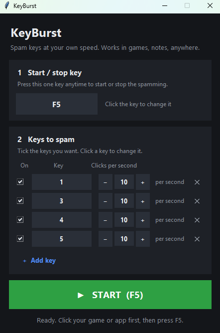

# KeyBurst

A small Windows app that spams keys for you, each at its own speed.

Pick the keys, set clicks per second for each one, and start or stop everything with a single key. It works in games, notes, and any other app that accepts key presses.



## Download

Get `KeyBurst.exe` from the [latest release](https://github.com/SeannyBoyyy/keyburst/releases/latest). No install and no Python needed.

Windows may show a warning for apps it does not know. The release notes have a SHA256 checksum so you can check your download.

## Features

- Spam any keys you choose, up to 12 at once
- Separate speed for every key (0.5 to 50 clicks per second)
- One key to start and stop (default `F6`), and you can change it
- Tick or untick a key to turn it on or off without deleting it
- Settings are saved automatically in `%APPDATA%\KeyBurst\config.json`

## Requirements

- Windows
- Python 3.9 or newer (tkinter comes with the standard Windows installer)

## Run from source

```powershell
git clone https://github.com/SeannyBoyyy/keyburst.git
cd keyburst
pip install -r requirements.txt
python app.py
```

## How to use

1. Click the big key under **Start / stop key** and press the one key you want.
2. Under **Keys to spam**, click a key to change it, and set how many clicks per second it gets.
3. Click your game or app so it is the active window.
4. Press your start/stop key. Press it again to stop.

Tips:

- Press the start/stop key while the game or app is focused. If you click the Start button in KeyBurst, the key presses go to the KeyBurst window instead.
- The start/stop key cannot also be a spam key.
- If a game ignores the key presses, run PowerShell as administrator.
- If key presses get missed, lower the clicks per second.

## Notes

- Some games ban macros and automation. Use this at your own risk.
- This project is not affiliated with Roblox or any game.
- Built on the [keyboard](https://github.com/boppreh/keyboard) library.

## Roadmap

- Dark and light theme switch
- Saved profiles (for example one per game)
- Optional stop after a set number of rounds
- System tray icon

## License

MIT. See [LICENSE](LICENSE).
